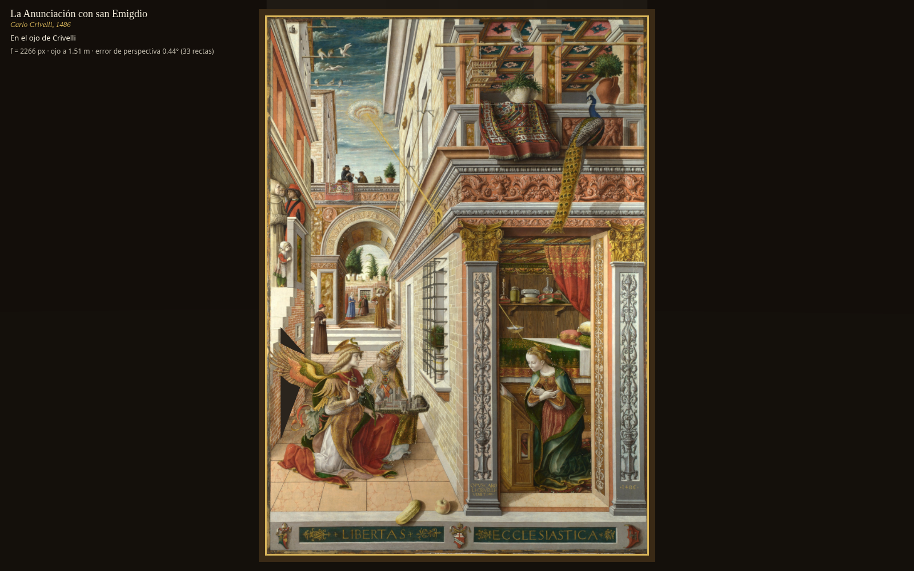
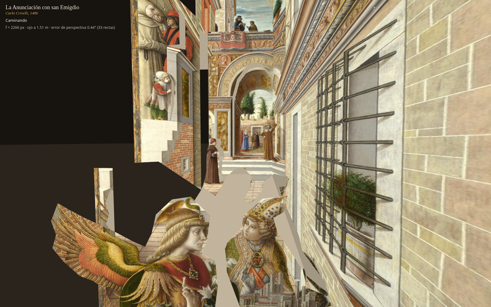

# Crivelli 3D: entrar en la *Anunciación con san Emigdio*

Reconstrucción 3D recorrible de *La Anunciación con san Emigdio* de Carlo Crivelli (1486, National Gallery, Londres, NG739) a partir de la geometría de su perspectiva. La página abre mostrando exactamente la pintura, vista desde el punto de vista calculado del pintor. Desde ahí se puede entrar a la calle y recorrerla. El botón **«Volver al ojo de Crivelli»** devuelve la cámara a ese punto, y el espacio vuelve a convertirse en la pintura.

Es el trabajo final de la electiva *Galileo* (Universidad Nacional de Colombia, Bogotá). Autor: **Sebastian Velandia Acevedo**.

Inspirado en el trabajo de Criminisi, Kemp y Zisserman sobre la *Flagelación* de Piero della Francesca y la *Trinidad* de Masaccio.



---

## Uso

```bash
npm install
npm run dev
```

- Visor: `http://localhost:5173/`
- Herramienta para marcar líneas: `http://localhost:5173/analysis/marcador.html`

| Control | Acción |
| --- | --- |
| Panel → *Volver al ojo de Crivelli* (o tecla `R`) | Anima la cámara de regreso al punto de vista del pintor |
| *Entrar y caminar* | Primera persona: clic para mirar con el mouse, `WASD` para moverse, `Shift` para correr, `Q`/`E` para bajar o subir, `Esc` para soltar el mouse |
| *Modo órbita* | Girar, acercar y desplazar con el mouse |
| *Modo maqueta* | Vista casi axonométrica de toda la reconstrucción |
| *Comprobar la geometría* | Superponer la pintura (con opacidad), líneas y punto de fuga en 3D, planta reconstruida, zonas ocultas |
| *Extras* | Perspectiva aérea según Leonardo, recorrido guiado de unos 60 s, captura PNG |

### Publicar gratis

```bash
npm run build
```

Genera `dist/` con rutas relativas (`base: './'`), así que sirve igual en **GitHub Pages** (por ejemplo, subiendo `dist/` a la rama `gh-pages`) que en **Vercel** (preset de Vite, comando `npm run build` y salida `dist`). No usa backend, servicios de pago ni claves de API.

### Repetir el análisis geométrico

```bash
python -m venv .venv && .venv/bin/pip install -r requirements.txt
.venv/bin/python analysis/geometry.py
```

Lee `analysis/data/lines.json` y escribe `public/data/calibration.json`, `docs/01_lineas_de_fuga.jpg`, `docs/02_planta_rectificada.png` y `analysis/out/reporte.md`. Si marcás líneas nuevas con `marcador.html`, exportá el JSON, reemplazá `analysis/data/lines.json` y volvé a correr el script.

---

## Imagen

- Archivo: `analysis/source/crivelli_ng739.jpg` (2996 × 4226 px). Para la web se usa una copia reducida, `public/painting/crivelli_ng739_2048.jpg`.
- Fuente: Wikimedia Commons, [*The Annunciation, with Saint Emidius - Carlo Crivelli - National Gallery.jpg*](https://commons.wikimedia.org/wiki/File:The_Annunciation,_with_Saint_Emidius_-_Carlo_Crivelli_-_National_Gallery.jpg). Crédito: National Gallery. Licencia: **dominio público**.
- Medidas del panel según esa ficha: 207 × 146,5 cm.

---

## Resultados

| Magnitud | Valor |
| --- | --- |
| Punto de fuga central | (791,4; 2284,3) px |
| Error de perspectiva | 0,44° de desviación angular media en 33 rectas (RMS de 20,6 px medido sobre las rectas prolongadas hasta el punto de fuga) |
| Distancia del ojo *f* | 2266 px (cuatro diagonales: 2212, 2217, 2273 y 2365 px) |
| Distancia de observación frente al panel real | ≈ 111 cm |
| Altura del ojo | ≈ 1,51 m (fraile: 1,53 m; Gabriel: 1,50 m) |
| Campo visual | 63° horizontal × 86° vertical |
| Tamaño de la baldosa | ≈ 36 cm |
| Homografía del piso | la DLT reproyecta con 5,7 px RMS y difiere de la analítica en 8,0 px |

Una curiosidad: el punto de distancia derecho que dan las baldosas de la hilera frontal cae en x ≈ 3003 px, prácticamente en el borde derecho del panel (2996 px). No sabemos si Crivelli lo hizo a propósito. Es una coincidencia notable y queda como pregunta abierta para la sustentación.

| | |
| --- | --- |
|  |  |
|  |  |

`docs/06_volviendo_al_ojo.png` muestra un cuadro de la animación de regreso al ojo.

---

## Las matemáticas

### 1. Rectas y puntos en coordenadas homogéneas

Un punto de la imagen es **p** = (u, v, 1). La recta que pasa por dos puntos es el producto cruz **l** = **p₁** × **p₂**, y la intersección de dos rectas también: **p** = **l₁** × **l₂**. Normalizamos **l** = (a, b, c) para que a² + b² = 1; así |**l** · **p**| es la distancia en píxeles del punto a la recta.

### 2. Punto de fuga por mínimos cuadrados (SVD)

Las ortogonales (rectas perpendiculares al cuadro) deberían cortarse todas en un mismo punto **v**, es decir, **l**ᵢ · **v** = 0. Con N rectas ruidosas armamos la matriz A (N × 3) cuyas filas son las **l**ᵢ y resolvemos

  min ‖A **v**‖² sujeto a ‖**v**‖ = 1.

La solución es el vector singular derecho de A con el menor valor singular. Antes normalizamos las coordenadas (Hartley) para que el problema esté bien condicionado. El **error de perspectiva** es la distancia de **v** a cada recta (RMS y máximo, en px) y el ángulo entre cada segmento y la dirección hacia **v**. El ángulo es la medida más justa, porque no depende de qué tan lejos del punto de fuga esté el segmento.

### 3. Horizonte y punto principal

En la *costruzione legittima* de Alberti el cuadro es vertical y las ortogonales son perpendiculares a él. Entonces el punto de fuga central es el **punto céntrico**, el pie de la perpendicular del ojo al cuadro (el *punto principal* de la cámara), y el horizonte es la recta horizontal y = v_y que pasa por él.

### 4. Distancia del ojo: los puntos de distancia

**Supuesto:** las baldosas son cuadradas. Sus diagonales forman 45° con el cuadro, así que fugan a los **puntos de distancia** (cx ± f, cy) sobre el horizonte. Por eso la distancia horizontal entre el punto de fuga y un punto de distancia es exactamente la distancia del ojo al cuadro, *f*, medida en píxeles. Usamos el promedio de cuatro diagonales.

### 5. Altura del ojo

Una figura vertical de altura h, parada sobre el piso a profundidad D, cumple

  v_pie − cy = f · Hc / D  y  v_pie − v_cabeza = f · h / D,

y dividiendo, **Hc = h · (v_pie − cy) / (v_pie − v_cabeza)**, que no depende ni de D ni de f.

**Supuestos:** el fraile del fondo mide 1,65 m con gorro y Gabriel arrodillado, 1,20 m. Los dos dan casi lo mismo (1,53 y 1,50 m).

Toda la escena hereda esta escala: con una sola vista, las longitudes absolutas solo se conocen salvo un factor, y ese factor lo fija Hc.

### 6. La cámara

Usamos un modelo estenopeico con el ojo en **E** = (0, Hc, 0), mirando hacia −Z, con distancia focal f y punto principal (cx, cy). El rayo por el píxel (u, v) es

  **d** = ((u − cx)/f, −(v − cy)/f, −1).

En three.js, el frustum de la cámara del pintor es exactamente el rectángulo de la imagen. En el plano *near* n:

  left = −cx·n/f, right = (W − cx)·n/f, top = cy·n/f, bottom = −(H − cy)·n/f

Es un frustum descentrado, porque el punto de fuga no está en el centro de la pintura. La cámara del visitante interpola esos bordes con los de una cámara simétrica normal. Así, al volver al ojo, el encuadre «se convierte» de manera continua en la pintura.

### 7. Homografía del piso y planta

Un punto del piso (X, 0, −D) se proyecta en u = cx + fX/D, v = cy + f·Hc/D. En coordenadas homogéneas eso es una homografía del plano (X, D) a la imagen:

```
      [u]   [ f   cx    0   ] [X]
    w [v] = [ 0   cy   f·Hc ] [D]
      [1]   [ 0    1    0   ] [1]
```

La planta (`docs/02_planta_rectificada.png`) se obtiene recorriendo una cuadrícula de (X, D) en metros, llevándola a la pintura con H y muestreando el color con interpolación bilineal. Como comprobación independiente, estimamos también H por **DLT** a partir de 11 esquinas de baldosas medidas a mano. Las dos coinciden con 8 px de diferencia RMS. Las figuras aparecen «estiradas» en la planta porque no están sobre el piso: es justamente lo que la homografía de un plano no puede representar.

### 8. Construcción de la escena (*Tour Into the Picture*)

`public/data/scene.json` describe cada elemento como un **polígono en píxeles** más un **plano**:

- `horizontal` (y = cte): piso, plataforma y techos.
- `side` (x = cte): las fachadas paralelas a la calle.
- `frontal` (z = cte): la fachada de María, el arco, el fondo y los cartones de las figuras.

Cada plano se fija con un **ancla**: un píxel que se proyecta sobre un elemento ya construido. Por ejemplo, la pared derecha se ancla en el punto donde su base toca el piso; el techo del cuarto, en la fachada; y la pared del fondo del cuarto, en el techo. Cada vértice se lleva a 3D cortando su rayo con el plano («lifting») y el polígono se triangula con sus huecos (la puerta, el arco).

Por construcción, cada vértice visto desde el ojo cae sobre su píxel. **Por eso la vista inicial coincide con la pintura.**

### 9. Texturas proyectivas y zonas ocultas

Cada fragmento se proyecta con la matriz (proyección · vista) del pintor. Sus coordenadas NDC, llevadas a [0, 1], son la coordenada de textura dentro de la pintura: es la ventana de Alberti al revés.

Para las zonas que el pintor nunca vio usamos la misma técnica que un *shadow map*. Primero renderizamos la profundidad de la escena desde el ojo. Si un fragmento está más lejos que lo primero que el ojo ve en esa dirección, queda oculto en la pintura y se pinta de color «yeso» neutro (con la opción *Resaltar zonas ocultas* se ve en rosa). Las caras traseras también son neutras: los cartones tienen el reverso liso.

---

## Supuestos y decisiones

1. **Un único punto de fuga.** Las líneas de la calle, de las fachadas y del techo del cuarto de María fugan al mismo punto; el cuadro es vertical.
2. **Baldosas cuadradas** para calcular la distancia del ojo.
3. **Alturas de las figuras:** el fraile del fondo mide 1,65 m (con gorro) y Gabriel arrodillado, 1,20 m. Fijan la escala.
4. **Escalones:** se modelan como un solo plano frontal (la contrahuella) más una plataforma horizontal. La altura que resulta, ≈ 0,6 m para tres escalones, es razonable.
5. **Pared del fondo de la logia:** se supone 1,5 m detrás de la fachada. La pintura no da otra pista. El techo de casetones se ancla a esa pared, y la logia resulta de unos 2 m de alto.
6. **Cuarto de María:** el techo se ancla en el borde superior de la puerta (sobre la fachada) y la pared del fondo, en la línea donde termina el techo. El cuarto resulta de ≈ 1,4 m de fondo y ≈ 2 m de alto.
7. **Paredes laterales:** la pintura no es perfectamente coherente. El muro derecho no sigue exactamente una sola recta hacia el punto de fuga a lo largo de toda la calle, así que tomamos la base cercana, la más nítida. Por eso al caminar aparecen algunas juntas.
8. **Lo que no se modela:** el balcón, las cornisas y los relieves quedan como planos («cartón pintado»), y la torre lejana va pintada sobre el fondo del cielo. Las figuras son cartones frontales recortados con polígonos trazados a mano.
9. **Profundidad del fondo:** el cielo y la ciudad lejana están en un plano a 70 m. Cualquier valor grande da la misma vista desde el ojo.

---

## Estructura

```
analysis/
  source/crivelli_ng739.jpg   imagen original (dominio público)
  data/lines.json             ortogonales, diagonales, esquinas de baldosas y figuras
  geometry.py                 punto de fuga, distancia, altura del ojo, homografía y planta
  marcador.html / .js         herramienta para marcar líneas sobre la pintura
  out/reporte.md              resumen numérico
public/
  data/calibration.json       resultado del análisis (lo lee la escena)
  data/scene.json             polígonos y planos de la reconstrucción
  data/planta.png             planta rectificada (panel del visor)
  painting/                   textura de la pintura (2048 px)
src/
  core/pictureSpace.js        rayos, planos, anclas, lifting y triangulación
  core/projectiveMaterial.js  shader de textura proyectiva y zonas ocultas
  core/cameras.js             cámara del pintor y cámara interpolable del visitante
  scene/perspectiveHelpers.js ventana de Alberti, ortogonales, puntos de distancia
  app/Viewer.js               modos (ojo, caminar, órbita, maqueta) y animaciones
  app/tour.js                 recorrido guiado
  main.js, style.css          panel lil-gui y superposiciones HTML
docs/                         capturas para la presentación
RESENA.md                     reseña de una página (objetivo y relación con Galileo)
```

---

## Plan de trabajo (unas 15 h)

| Hito | Horas | Estado |
| --- | --- | --- |
| 1. Imagen, marcado de líneas, punto de fuga y error | 2 | ✅ |
| 2. Distancia del ojo, altura, homografía y planta | 2 | ✅ |
| 3. Cámara alineada en three.js y superposición | 2 | ✅ |
| 4. Piso, fachadas, interior y fondo (scene.json) | 3 | ✅ |
| 5. Cartones de las figuras | 1,5 | ✅ |
| 6. Controles, «Volver al ojo» y panel | 2 | ✅ |
| 7. README, RESENA y capturas | 1,5 | ✅ |
| 8. Extras: perspectiva aérea y recorrido guiado | 1 | ✅ (básicos) |

**Mejoras posibles:** recortar las figuras con máscaras de píxeles en lugar de polígonos, modelar los escalones uno por uno, darle volumen al balcón y a la cornisa, y rellenar las zonas ocultas con texturas sintetizadas (*inpainting*).

---

## Fuentes

- A. Criminisi, I. Reid y A. Zisserman, «Single View Metrology», *International Journal of Computer Vision* 40(2), 2000.
- A. Criminisi, M. Kemp y A. Zisserman, «Bringing Pictorial Space to Life: Computer Techniques for the Analysis of Paintings», 2003.
- Y. Horry, K. Anjyo y K. Arai, «Tour Into the Picture», *SIGGRAPH* 1997.
- M. Kemp, *The Science of Art: Optical Themes in Western Art from Brunelleschi to Seurat*, Yale University Press, 1990.
- E. Panofsky, *Galileo as a Critic of the Arts*, Martinus Nijhoff, 1954.
- L. B. Alberti, *De pictura*, 1435.

## Licencia

Código bajo licencia MIT. La imagen de la pintura es de dominio público (ver arriba).
