# Crivelli 3D: entrar en la *Anunciación con san Emigdio*

Reconstrucción 3D recorrible de *La Anunciación con san Emigdio* de Carlo Crivelli (1486, National Gallery, Londres, NG739) a partir de la geometría de su perspectiva.

La página abre en una sala de museo, con el cuadro colgado a su tamaño real. En el piso hay una marca: el punto exacto donde estaba el ojo del pintor, calculado a partir de la pintura. El botón **«Volver al ojo de Crivelli»** lleva la cámara hasta ahí. Desde ese punto el cuadro se vuelve transparente y la imagen no cambia, porque detrás hay un espacio 3D que proyecta exactamente la pintura. Después se puede entrar a la calle, recorrerla, medirla y volver al ojo, donde el espacio vuelve a convertirse en la pintura.

Demo: <https://crivelli-3d.vercel.app/>

Es el trabajo final de la electiva *Galileo* (Universidad Nacional de Colombia, Bogotá). Autor: **Sebastian Velandia Acevedo**.

Inspirado en el trabajo de Criminisi, Kemp y Zisserman sobre la *Flagelación* de Piero della Francesca y la *Trinidad* de Masaccio.


---

## Uso

```bash
npm install
npm run dev
```

- Visor: `http://localhost:5173/`
- Marcador: `http://localhost:5173/analysis/marcador.html`. Tiene dos modos: *Líneas de fuga* y *Polígonos de la escena*. El segundo es un editor: arrastrar vértices, clic en una arista para agregar uno, `Alt`+clic para borrarlo.

| Control | Acción |
| --- | --- |
| Panel → *Volver al ojo de Crivelli* (o tecla `R`) | Anima la cámara de regreso al punto de vista del pintor |
| *Volver al museo* | Vuelve a la sala: el cuadro es otra vez un objeto colgado |
| *Entrar y caminar* | En escritorio, haz clic para mirar con el mouse. Usa `WASD` para moverte, `Shift` para correr y `Q`/`E` para bajar o subir la vista. Pulsa `Esc` para soltar el mouse. En una pantalla táctil, arrastra para mirar y usa las flechas para avanzar o retroceder. |
| *Avanzado → Modo órbita* | Girar, acercar y desplazar con el mouse |
| *Modo maqueta* | Vista casi axonométrica de toda la reconstrucción |
| *Avanzado → Lo que Crivelli no pintó* | Modo fiel, neutro (por defecto) o inferido; marcar lo inferido; aristas medido/supuesto |
| *Medir* | Selecciona dos puntos para obtener una distancia en metros. Al caminar, apunta con la mira y selecciona cada punto con un clic. También hay mediciones sugeridas. |
| *Avanzado → Comprobar la geometría* | Superponer la pintura (con opacidad), líneas y punto de fuga en 3D, planta reconstruida |
| *Recorrido guiado* | 11 paradas en 73 s de reproducción. Usa **Pausar**, **Siguiente** o **Detener**. `Esc` también detiene el recorrido. |
| *Avanzado → Extras* | Perspectiva aérea según Leonardo y captura PNG |

### Publicar gratis

```bash
npm run build
```

Genera `dist/` con rutas relativas (`base: './'`), así que sirve igual en **GitHub Pages** (por ejemplo, subiendo `dist/` a la rama `gh-pages`) que en **Vercel** (preset de Vite, comando `npm run build` y salida `dist`). No usa backend, servicios de pago ni claves de API.

### Repetir el análisis geométrico

```bash
python -m venv .venv && .venv/bin/pip install -r requirements.txt
.venv/bin/python analysis/geometry.py
```

Lee `analysis/data/lines.json` y escribe `public/data/calibration.json`, `docs/01_lineas_de_fuga.jpg`, `docs/02_planta_rectificada.png` y `analysis/out/reporte.md`. Si marcás líneas nuevas con `marcador.html`, exportá el JSON, reemplazá `analysis/data/lines.json` y volvé a correr el script.

### Repetir el modo inferido

```bash
.venv/bin/python analysis/infer.py
```

Lee `scene.json` y `calibration.json`, y hornea `public/textures/*.jpg`, `public/data/textures.json` y `docs/07_mascaras_de_evidencia.jpg` (tarda alrededor de un minuto). Hay que volver a correrlo cada vez que cambie la escena.

---

## Tres modos: lo pintado y lo inferido

Desde el ojo de Crivelli los modos son indistinguibles: todo lo que se ve es la pintura. La diferencia aparece al entrar y mirar lo que el pintor no mostró. El panel *Lo que Crivelli no pintó* tiene tres opciones:

| Modo | Qué se ve donde no hay pintura |
| --- | --- |
| **Fiel al cuadro** | Nada: el fragmento se descarta y se ve el hueco de información. Además se dibujan las aristas de cada plano: blanco si su posición se **midió** en la pintura, ámbar discontinuo si es un **supuesto** (por ejemplo, la logia a 1,5 m de la fachada). |
| **Neutro (yeso)** — por defecto | Un color neutro, sin textura inventada. |
| **Inferido** | Una textura horneada offline por `analysis/infer.py` (inpainting en muros y fondos; el piso queda neutro). *Marcar lo inferido* la cubre con un rayado rosa. |

Cada elemento de `scene.json` lleva:
- `evidence`: `measured` o `assumed`, con una `note` que explica el supuesto.
- `fill`: la regla para completar lo oculto en el modo inferido.

**Un intento descartado: la regla de las baldosas.** Se probó completar el piso oculto repitiendo una baldosa real rectificada, con su tamaño medido (36 cm), una de las 8 simetrías del cuadrado en cada celda y las juntas dibujadas por regla. La geometría era correcta, pero el tono de la baldosa repetida no coincide con el piso pintado, porque Crivelli sombrea el piso de manera continua. El resultado: al caminar se veía el contorno de cada figura dibujado en el piso. Una regla geométrica correcta no alcanza si la *apariencia* no sigue la misma regla, así que el piso volvió a quedar neutro. El código sigue en `infer.py` (`fill: "tiles"`) para documentar el experimento.

El modo inferido rellena el resto **por continuidad (inpainting)**: El resto se rellena con *Frequency Selective Reconstruction* (OpenCV xphoto), que reconstruye textura y no solo color, a partir de lo visto en el mismo plano. Lejos de los datos (más de ~0,5 m) el relleno se funde con el color medio del elemento: ahí cualquier detalle sería inventado.

**Cómo se sabe qué vio el pintor.** `infer.py` calcula un z-buffer analítico en la imagen: cada elemento es un plano, así que la profundidad de cada píxel sale de cortar su rayo con el plano. Un texel de un elemento está «visto» si, proyectado a la pintura, no hay otro elemento más cerca del ojo. Es el mismo criterio que usa el shader en tiempo real.

La lámina `docs/07_mascaras_de_evidencia.jpg` muestra, para cada elemento, qué fracción vio el pintor (por ejemplo, del piso de la calle solo el 25 %; de la fachada de María, el 96 %).

El borde lejano del muro derecho se recortó donde empieza el puente para dejar a la vista al hombre del manto dorado y la maceta. En el balcón izquierdo, se recortó el muro lateral y se retranqueó el fondo para conservar la oclusión de las figuras según sus siluetas.

---

## Siluetas, medición y museo

### Siluetas con GrabCut (`analysis/segment.py`)

Los recortes de las figuras empezaron como polígonos trazados a mano (de 6 a 49 vértices), que arrastraban fondo: la franja del pilar detrás de Gabriel, el piso entre sus alas. Ahora cada polígono a mano es solo la región de interés (`roi`) con la que se inicializa **GrabCut** (OpenCV), que separa figura y fondo modelando sus colores y cortando un grafo. El contorno resultante, simplificado a 1,5 px, reemplaza al polígono (hasta 362 vértices en Gabriel). No necesita descargar ningún modelo. Lo que GrabCut no resuelva (por ejemplo, el niño arrastra un poco del muro blanco) se corrige con el editor del marcador. `docs/11_siluetas.jpg` muestra cada resultado junto a su ROI.

**Versión final:** las diez siluetas se corrigieron a mano en el editor del marcador, partiendo del resultado de GrabCut (entre 49 y 879 vértices por figura). Quedan marcadas como `"silhouette": "manual"`, así que `segment.py` ya no las sobrescribe salvo que se le pida una figura por nombre.

```bash
.venv/bin/python analysis/segment.py && .venv/bin/python analysis/infer.py
```

### Medir dentro de la pintura

Es la idea central de la *single view metrology* de Criminisi: cada clic es un rayo que corta el plano del elemento que toca, así que dos clics dan una distancia en metros. Desde el ojo de Crivelli equivale a medir **sobre la pintura**. Mediciones sugeridas (`src/app/measure.js`):

| Medición | Resultado |
| --- | --- |
| Ancho de una baldosa | 36 cm |
| Ancho de la calle | 2,30 m |
| La Virgen, arrodillada | 1,22 m |
| Gabriel, arrodillado | 1,23 m |
| Hombre del manto dorado, de pie (a 12 m del ojo) | 1,83 m |
| Profundidad del cuarto de María | 1,57 m |
| Alto del techo del cuarto | 2,03 m |
| Puente sobre la plataforma | 7,23 m |

**Hallazgo: la escala de Crivelli es coherente.** Calibrada solo con el fraile del fondo y con Gabriel, la reconstrucción da a la Virgen y a Gabriel la misma altura arrodillados (1,22 y 1,23 m), y al hombre del manto dorado, que está cuatro veces más lejos, una estatura plausible de pie (1,83 m). Crivelli no usa aquí la escala jerárquica medieval: las figuras sagradas obedecen la misma perspectiva que los transeúntes.

### El museo y la ventana de Alberti (`src/scene/museum.js`)

El cuadro de la sala no está colocado a ojo: es la ventana de Alberti calculada. Mide 146,5 cm de ancho, está a 111 cm del ojo y tiene el punto de fuga a 1,51 m de altura. Por eso el piso de la sala es el mismo plano que el piso de la calle pintada, y la base del cuadro queda a unos 56 cm del suelo. Al llegar al ojo, el cuadro se vuelve transparente sin que la imagen cambie. El anillo y la cartela señalan el punto en el piso, y una esfera indica la altura del ojo. La maqueta conserva la línea vertical auxiliar para leer esa altura respecto del suelo.

Un portal de stencil restringe el dibujo de la calle al interior del marco cuando se mira desde la sala. El mapa de profundidad de la pintura se calcula por separado. Al caminar, los límites amortiguan el movimiento hacia las paredes. El marco permite cruzar en ambos sentidos una vez abierto y el paso sobre los escalones del fondo eleva al visitante hasta la plataforma. Entre el marco y el piso pintado hay un pequeño umbral de yeso marcado como `assumed`, visible desde la calle y excluido del mapa de profundidad. En órbita y maqueta se ocultan la sala y el portal.

### Escalera del niño y balcón izquierdo

Se adoptó la hipótesis A. La junta visible del bloque con la sillería lateral, cerca de `u = 300`, fija el frente a **7,53 m** si se aproxima por un plano frontal. El apoyo de los pies del niño, cerca de `(120, 2129)`, levanta el descanso a **2,03 m** sobre la calle. Usar un pie de escalera en `v = 2650` daría **9,38 m** de profundidad. La parte inferior queda tapada por el ala de Gabriel, así que esa alternativa depende de un contacto con el piso que no se observa.

El canto visible y su sucesión de alturas guían cinco huellas y contrahuellas. El modelo supone una arista a X constante y separa el frente del parapeto de su cara lateral. La sillería conserva el plano lateral medido. El nuevo bloque, el fondo retranqueado del balcón y los anclajes de las figuras se marcan como `assumed`. Las diez siluetas manuales se conservan.

| Figura | Altura en el modelo | Referencia |
| --- | --- | --- |
| Niño | 1,21 m | Extremos de la silueta manual, incluido el gorro |
| Hombre de la izquierda | 1,77 m | Tocado en `v ≈ 1274` |
| Hombre del centro | 1,58 m | Tocado en `v ≈ 1330` |
| Hombre de la derecha | 1,65 m | Tocado en `v ≈ 1310` |

Las tres estaturas adultas se calculan con el mismo plano frontal y un apoyo supuesto a **3,10 m** de altura. La pintura oculta sus pies. Estas cifras dependen del nivel elegido para el balcón y no son mediciones independientes de la pintura.

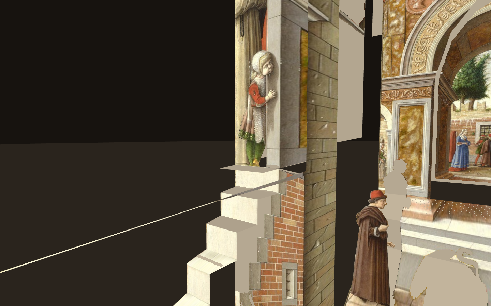

| | |
| --- | --- |
| 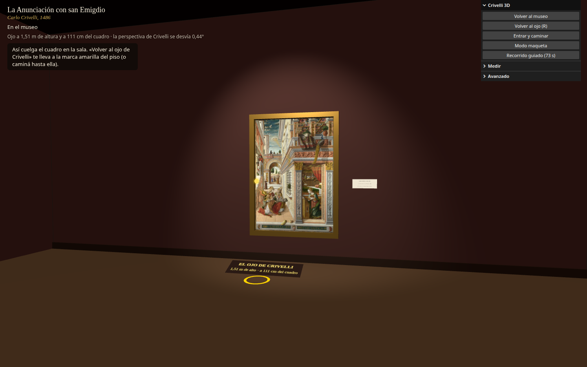 | 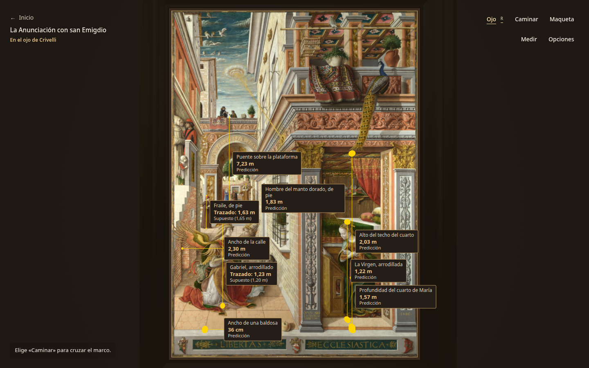 |
| 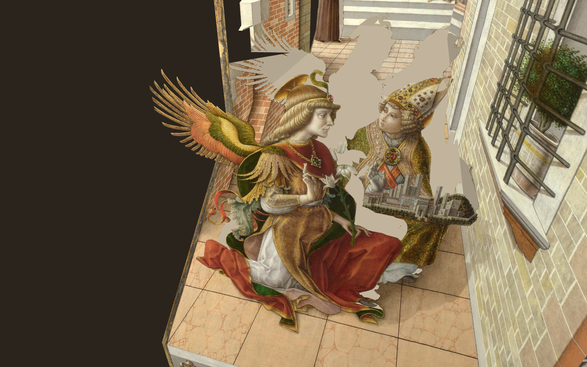 | 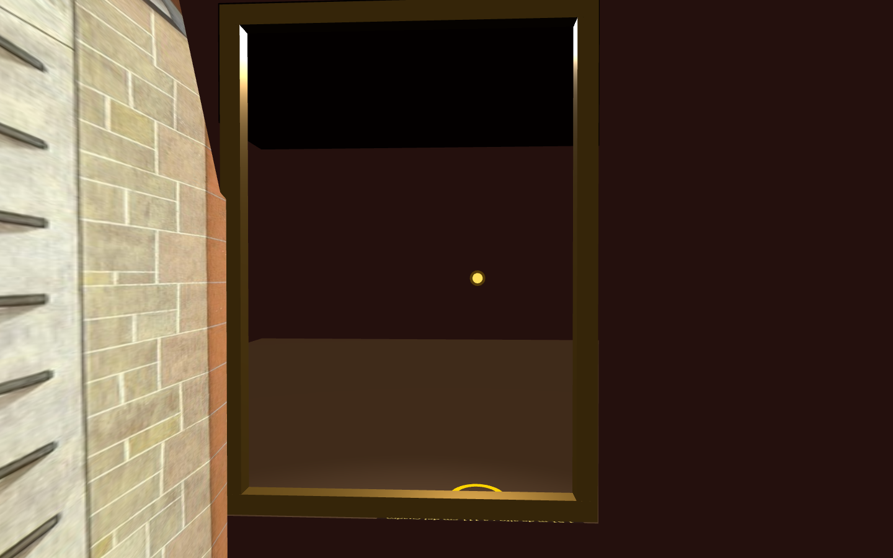 |

---

## Imagen

- Archivo: `analysis/source/crivelli_ng739.jpg` (2996 × 4226 px). Para la web se usa una copia reducida, `public/painting/crivelli_ng739_2048.jpg`.
- Fuente: Wikimedia Commons, [*The Annunciation, with Saint Emidius - Carlo Crivelli - National Gallery.jpg*](https://commons.wikimedia.org/wiki/File:The_Annunciation,_with_Saint_Emidius_-_Carlo_Crivelli_-_National_Gallery.jpg). Crédito: National Gallery. Licencia: **dominio público**.
- Medidas del panel según esa ficha: 207 × 146,5 cm.

---

## Resultados

| Magnitud | Valor |
| --- | --- |
| Punto de fuga central | (791,4; 2284,3) px |
| Error de perspectiva | 0,44° de desviación angular media en 33 rectas (RMS de 20,6 px medido sobre las rectas prolongadas hasta el punto de fuga) |
| Distancia del ojo *f* | 2266 px (cuatro diagonales: 2212, 2217, 2273 y 2365 px) |
| Distancia de observación frente al panel real | ≈ 111 cm |
| Altura del ojo | ≈ 1,51 m (fraile: 1,53 m; Gabriel: 1,50 m) |
| Campo visual | 63° horizontal × 86° vertical |
| Tamaño de la baldosa | ≈ 36 cm |
| Homografía del piso | la DLT reproyecta con 5,7 px RMS y difiere de la analítica en 8,0 px |

Una curiosidad: el punto de distancia derecho que dan las baldosas de la hilera frontal cae en x ≈ 3003 px, prácticamente en el borde derecho del panel (2996 px). No sabemos si Crivelli lo hizo a propósito. Es una coincidencia notable y queda como pregunta abierta para la sustentación.

| | |
| --- | --- |
| 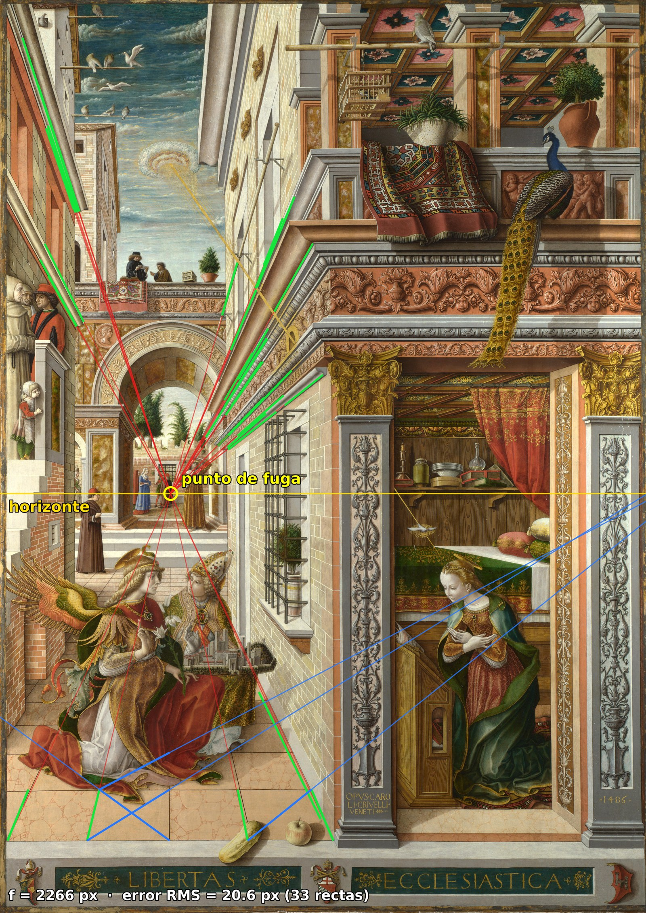 | 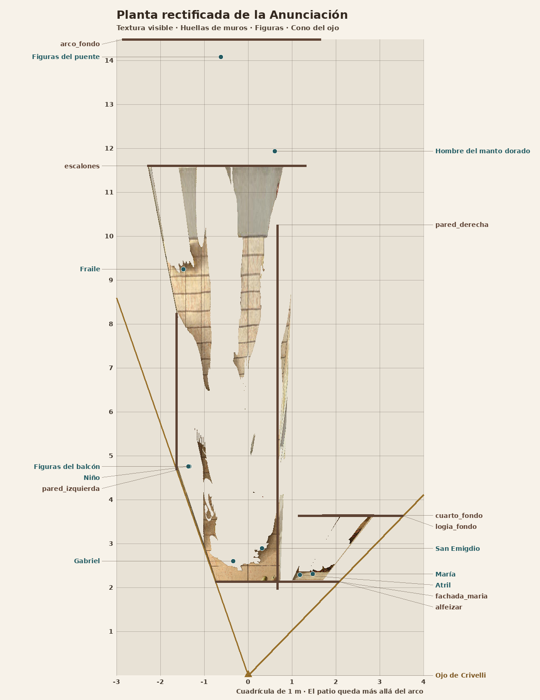 |
|  | 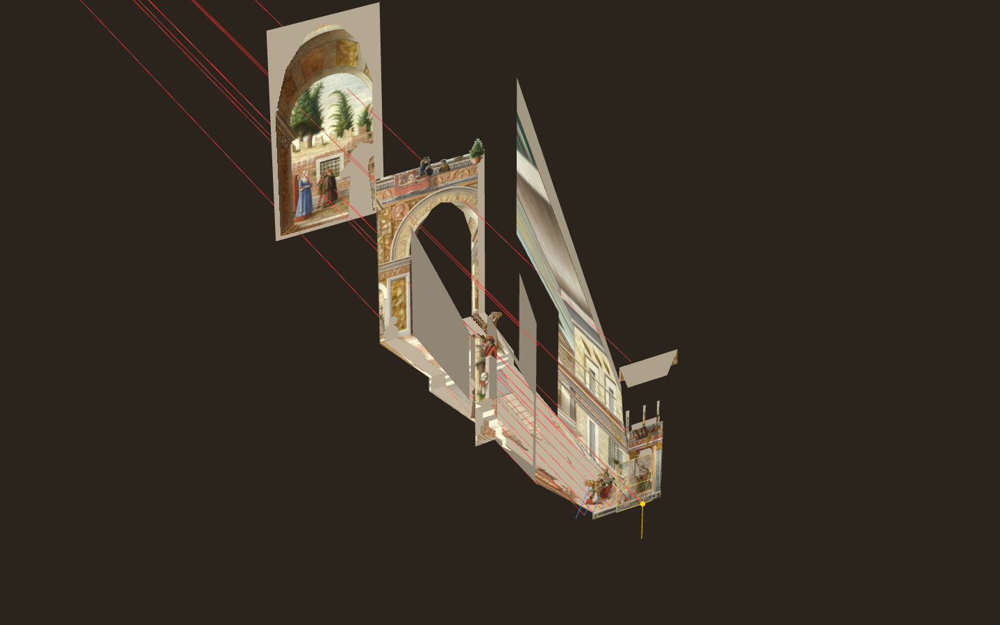 |

`docs/06_volviendo_al_ojo.png` muestra un cuadro de la animación de regreso al ojo.

| Modo fiel | Modo inferido |
| --- | --- |
| 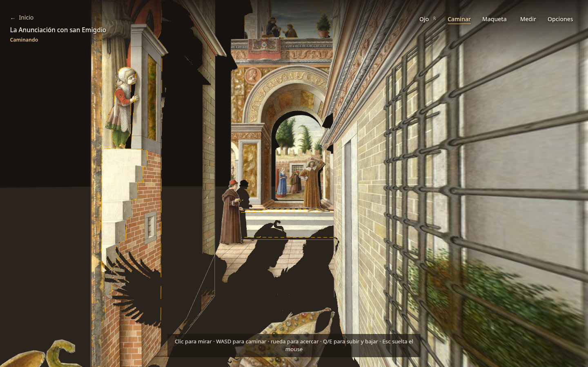 | 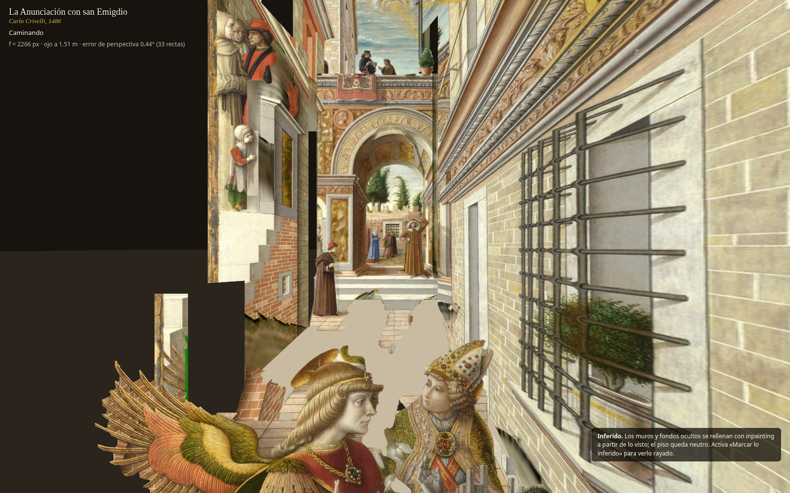 |

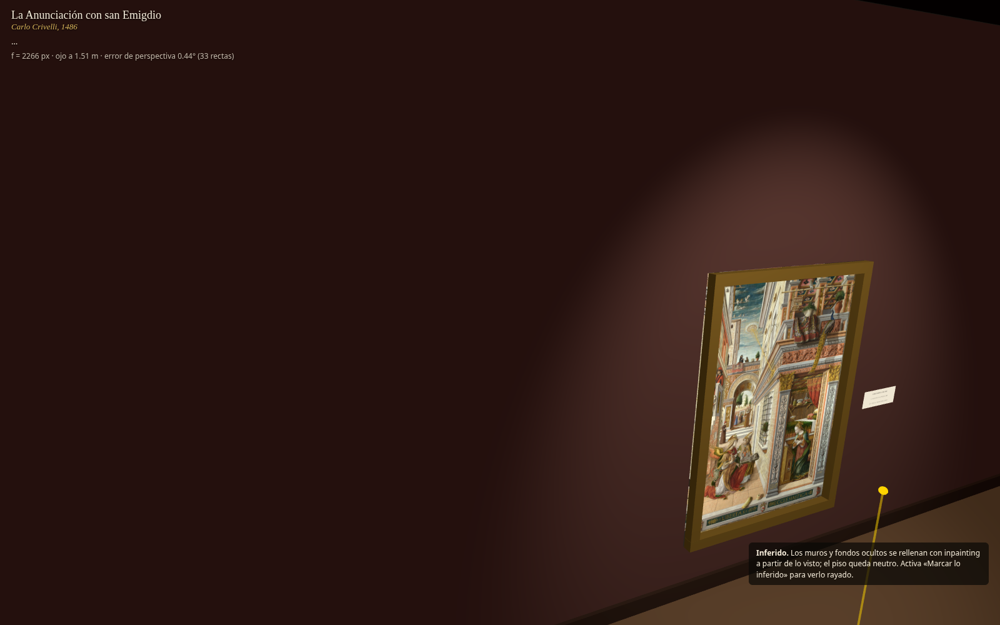

---

## Las matemáticas

### 1. Rectas y puntos en coordenadas homogéneas

Un punto de la imagen es **p** = (u, v, 1). La recta que pasa por dos puntos es el producto cruz **l** = **p₁** × **p₂**, y la intersección de dos rectas también: **p** = **l₁** × **l₂**. Normalizamos **l** = (a, b, c) para que a² + b² = 1; así |**l** · **p**| es la distancia en píxeles del punto a la recta.

### 2. Punto de fuga por mínimos cuadrados (SVD)

Las ortogonales (rectas perpendiculares al cuadro) deberían cortarse todas en un mismo punto **v**, es decir, **l**ᵢ · **v** = 0. Con N rectas ruidosas armamos la matriz A (N × 3) cuyas filas son las **l**ᵢ y resolvemos

  min ‖A **v**‖² sujeto a ‖**v**‖ = 1.

La solución es el vector singular derecho de A con el menor valor singular. Antes normalizamos las coordenadas (Hartley) para que el problema esté bien condicionado. El **error de perspectiva** es la distancia de **v** a cada recta (RMS y máximo, en px) y el ángulo entre cada segmento y la dirección hacia **v**. El ángulo es la medida más justa, porque no depende de qué tan lejos del punto de fuga esté el segmento.

### 3. Horizonte y punto principal

En la *costruzione legittima* de Alberti el cuadro es vertical y las ortogonales son perpendiculares a él. Entonces el punto de fuga central es el **punto céntrico**, el pie de la perpendicular del ojo al cuadro (el *punto principal* de la cámara), y el horizonte es la recta horizontal y = v_y que pasa por él.

### 4. Distancia del ojo: los puntos de distancia

**Supuesto:** las baldosas son cuadradas. Sus diagonales forman 45° con el cuadro, así que fugan a los **puntos de distancia** (cx ± f, cy) sobre el horizonte. Por eso la distancia horizontal entre el punto de fuga y un punto de distancia es exactamente la distancia del ojo al cuadro, *f*, medida en píxeles. Usamos el promedio de cuatro diagonales.

### 5. Altura del ojo

Una figura vertical de altura h, parada sobre el piso a profundidad D, cumple

  v_pie − cy = f · Hc / D  y  v_pie − v_cabeza = f · h / D,

y dividiendo, **Hc = h · (v_pie − cy) / (v_pie − v_cabeza)**, que no depende ni de D ni de f.

**Supuestos:** el fraile del fondo mide 1,65 m con gorro y Gabriel arrodillado, 1,20 m. Los dos dan casi lo mismo (1,53 y 1,50 m).

Toda la escena hereda esta escala: con una sola vista, las longitudes absolutas solo se conocen salvo un factor, y ese factor lo fija Hc.

### 6. La cámara

Usamos un modelo estenopeico con el ojo en **E** = (0, Hc, 0), mirando hacia −Z, con distancia focal f y punto principal (cx, cy). El rayo por el píxel (u, v) es

  **d** = ((u − cx)/f, −(v − cy)/f, −1).

En three.js, el frustum de la cámara del pintor es exactamente el rectángulo de la imagen. En el plano *near* n:

  left = −cx·n/f, right = (W − cx)·n/f, top = cy·n/f, bottom = −(H − cy)·n/f

Es un frustum descentrado, porque el punto de fuga no está en el centro de la pintura. La cámara del visitante interpola esos bordes con los de una cámara simétrica normal. Así, al volver al ojo, el encuadre «se convierte» de manera continua en la pintura.

### 7. Homografía del piso y planta

Un punto del piso (X, 0, −D) se proyecta en u = cx + fX/D, v = cy + f·Hc/D. En coordenadas homogéneas eso es una homografía del plano (X, D) a la imagen:

```
      [u]   [ f   cx    0   ] [X]
    w [v] = [ 0   cy   f·Hc ] [D]
      [1]   [ 0    1    0   ] [1]
```

La planta (`docs/02_planta_rectificada.png`) se obtiene recorriendo una cuadrícula de (X, D) en metros, llevándola a la pintura con H y muestreando el color con interpolación bilineal. Como comprobación independiente, estimamos también H por **DLT** a partir de 11 esquinas de baldosas medidas a mano. Las dos coinciden con 8 px de diferencia RMS. Las figuras aparecen «estiradas» en la planta porque no están sobre el piso: es justamente lo que la homografía de un plano no puede representar.

### 8. Construcción de la escena (*Tour Into the Picture*)

`public/data/scene.json` describe cada elemento como un **polígono en píxeles** más un **plano**:

- `horizontal` (y = cte): piso, plataforma y techos.
- `side` (x = cte): las fachadas paralelas a la calle.
- `frontal` (z = cte): la fachada de María, el arco, el fondo y los cartones de las figuras.

Cada plano se fija con un **ancla**: un píxel que se proyecta sobre un elemento ya construido. Por ejemplo, la pared derecha se ancla en el punto donde su base toca el piso; el techo del cuarto, en la fachada; y la pared del fondo del cuarto, en el techo. Cada vértice se lleva a 3D cortando su rayo con el plano («lifting») y el polígono se triangula con sus huecos (la puerta, el arco).

Por construcción, cada vértice visto desde el ojo cae sobre su píxel. **Por eso la vista inicial coincide con la pintura.**

### 9. Texturas proyectivas y zonas ocultas

Cada fragmento se proyecta con la matriz (proyección · vista) del pintor. Sus coordenadas NDC, llevadas a [0, 1], son la coordenada de textura dentro de la pintura: es la ventana de Alberti al revés.

Desde la posición exacta del ojo el propio render resuelve qué superficie se ve primero, y todas las superficies de un mismo rayo muestrean el mismo píxel. Fuera del ojo, para las zonas que el pintor nunca vio usamos la misma técnica que un *shadow map*. Primero renderizamos la profundidad de la escena desde el ojo. Si un fragmento está más lejos que lo primero que el ojo ve en esa dirección, queda oculto en la pintura y se pinta de color «yeso» neutro (con la opción *Resaltar zonas ocultas* se ve en rosa). Las caras traseras también son neutras: los cartones tienen el reverso liso.

---

## Supuestos y decisiones

1. **Un único punto de fuga.** Las líneas de la calle, de las fachadas y del techo del cuarto de María fugan al mismo punto; el cuadro es vertical.
2. **Baldosas cuadradas** para calcular la distancia del ojo.
3. **Alturas de las figuras:** el fraile del fondo mide 1,65 m (con gorro) y Gabriel arrodillado, 1,20 m. Fijan la escala.
4. **Escalones:** se modelan como un solo plano frontal (la contrahuella) más una plataforma horizontal. La altura que resulta, ≈ 0,6 m para tres escalones, es razonable.
5. **Pared del fondo de la logia:** se supone 1,5 m detrás de la fachada. La pintura no da otra pista. El techo de casetones se ancla a esa pared, y la logia resulta de unos 2 m de alto.
6. **Cuarto de María:** el techo se ancla en el borde superior de la puerta (sobre la fachada) y la pared del fondo, en la línea donde termina el techo. El cuarto resulta de ≈ 1,4 m de fondo y ≈ 2 m de alto.
7. **Paredes laterales:** la pintura no es perfectamente coherente. El muro derecho no sigue exactamente una sola recta hacia el punto de fuga a lo largo de toda la calle, así que tomamos la base cercana, la más nítida. Por eso al caminar aparecen algunas juntas.
8. **Lo que no se modela:** las cornisas y los relieves conservan su representación plana, y la torre lejana va pintada sobre el fondo del cielo. Las figuras son cartones frontales recortados con polígonos trazados a mano.
9. **Profundidad del fondo:** el cielo y la ciudad lejana están en un plano a 70 m. Cualquier valor grande da la misma vista desde el ojo.

---

## Estructura

```
analysis/
  source/crivelli_ng739.jpg   imagen original (dominio público)
  data/lines.json             ortogonales, diagonales, esquinas de baldosas y figuras
  geometry.py                 punto de fuga, distancia, altura del ojo, homografía y planta
  marcador.html / .js         herramienta para marcar líneas sobre la pintura
  out/reporte.md              resumen numérico
  scene3d.py                  la geometría de la escena en Python (igual que pictureSpace.js)
  infer.py                    modo inferido: z-buffer, texturas planas, regla de baldosas e inpainting
  segment.py                  siluetas de las figuras con GrabCut
  polygonEditor.js            editor de polígonos del marcador
public/
  data/calibration.json       resultado del análisis (lo lee la escena)
  data/scene.json             polígonos y planos de la reconstrucción
  data/planta.png             planta rectificada (panel del visor)
  data/textures.json          límites y estadísticas de las texturas inferidas
  textures/                   texturas planas por elemento (modo inferido)
  painting/                   textura de la pintura (2048 px)
src/
  core/pictureSpace.js        rayos, planos, anclas, lifting y triangulación
  core/projectiveMaterial.js  shader de textura proyectiva y zonas ocultas
  core/cameras.js             cámara del pintor y cámara interpolable del visitante
  scene/perspectiveHelpers.js ventana de Alberti, ortogonales, puntos de distancia
  app/Viewer.js               modos (ojo, caminar, órbita, maqueta) y animaciones
  app/tour.js                 recorrido guiado
  app/measure.js              herramienta de medición y mediciones sugeridas
  scene/museum.js             sala de museo con el cuadro como ventana de Alberti
  main.js, style.css          panel lil-gui y superposiciones HTML
docs/                         capturas para la presentación
RESENA.md                     reseña de una página (objetivo y relación con Galileo)
```

---

## Plan de trabajo (unas 15 h)

| Hito | Horas | Estado |
| --- | --- | --- |
| 1. Imagen, marcado de líneas, punto de fuga y error | 2 | ✅ |
| 2. Distancia del ojo, altura, homografía y planta | 2 | ✅ |
| 3. Cámara alineada en three.js y superposición | 2 | ✅ |
| 4. Piso, fachadas, interior y fondo (scene.json) | 3 | ✅ |
| 5. Cartones de las figuras | 1,5 | ✅ |
| 6. Controles, «Volver al ojo» y panel | 2 | ✅ |
| 7. README, RESENA y capturas | 1,5 | ✅ |
| 8. Extras: perspectiva aérea y recorrido guiado | 1 | ✅ (básicos) |
| 9. Modos fiel, neutro e inferido (evidencia, inpainting) | 4 | ✅ |
| 10. Siluetas con GrabCut y editor de polígonos | 2 | ✅ |
| 11. Herramienta de medición | 2 | ✅ |
| 12. Museo y ventana de Alberti | 3 | ✅ |
| 13. Portal, límites de marcha y marca del ojo | — | ✅ |
| 14. Escalera y balcón con profundidad documentada | — | ✅ |
| 15. Recorrido con mediciones y controles para pantallas táctiles | — | ✅ |

**Pendientes:** cerrar el cuarto de María con caras laterales, dar grosor a pilastras y cornisas, y explorar la sensibilidad de la reconstrucción a la altura de referencia y la distancia focal.

---

## Fuentes

- A. Criminisi, I. Reid y A. Zisserman, «Single View Metrology», *International Journal of Computer Vision* 40(2), 2000.
- A. Criminisi, M. Kemp y A. Zisserman, «Bringing Pictorial Space to Life: Computer Techniques for the Analysis of Paintings», 2003.
- Y. Horry, K. Anjyo y K. Arai, «Tour Into the Picture», *SIGGRAPH* 1997.
- M. Kemp, *The Science of Art: Optical Themes in Western Art from Brunelleschi to Seurat*, Yale University Press, 1990.
- E. Panofsky, *Galileo as a Critic of the Arts*, Martinus Nijhoff, 1954.
- L. B. Alberti, *De pictura*, 1435.

## Licencia

Código bajo licencia MIT. La imagen de la pintura es de dominio público (ver arriba).
